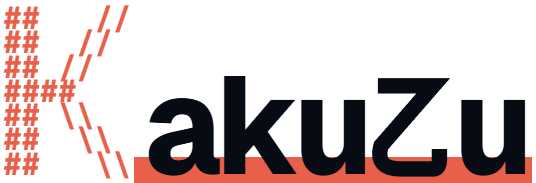

<div align="center">

<h1>
  <picture>
    <source media="(prefers-color-scheme: dark)" srcset="docs/wordmark-dark.png" />
    
  </picture>
</h1>

**Suivi de budget mobile, sans pub, avec un étang ASCII qui vit derrière les chiffres.**

[](https://github.com/PennecStv/kakuzu/actions/workflows/ci.yml)


[](LICENSE)

[](https://react.dev)
[](https://www.typescriptlang.org)
[](https://vite.dev)
[](https://vite-pwa-org.netlify.app)
[](https://zustand.docs.pmnd.rs)
[](https://nodejs.org)

<br />


</div>

---

## 一 · Pourquoi

Les applis de budget gratuites affichent une pub à chaque ouverture. Kakuzu fait la même chose sans pub, sans compte et sans serveur : les données restent dans le navigateur du téléphone, et l'appli marche hors ligne une fois installée.

## 二 · Ce qu'elle fait

| Écran      | Contenu                                                                                                       |
| ---------- | ------------------------------------------------------------------------------------------------------------- |
| Accueil    | Solde du mois, revenus et dépenses, courbe sur six mois, camembert des dépenses par catégorie, budgets restants, dernières opérations |
| Opérations | Historique du mois groupé par jour, recherche par note ou catégorie, filtre dépenses / revenus                |
| Catégories | Catégories de dépenses et de revenus, icône, couleur, budget mensuel                                          |
| Réglages   | Thème animé, devise, export JSON et CSV, import, remise à zéro                                                |

- **Ajout en trois gestes** : le bouton `+` ouvre une feuille avec le pavé numérique déjà ouvert, on choisit la catégorie et on valide.
- **Un message à chaque ajout** : vert pour un revenu (« Racks on racks on racks... »), rouge pour une dépense (« Not stonks... »).
- **Couleurs de catégorie libres** : douze couleurs bien distinctes, ou n'importe quelle couleur avec la pipette.
- **Courbe sur six mois** : revenus et dépenses mois par mois, jusqu'au mois affiché. Glisser le doigt sur la courbe lit un autre mois.
- **Annuler une suppression** : chaque suppression propose « Annuler » pendant cinq secondes.
- **Camembert lisible** : six parts au plus, la fin de liste est regroupée dans « Autres ». Toucher une part, ou sa ligne, affiche son montant au centre.
- **Export pour tableur** : le CSV utilise le point-virgule et la virgule décimale, Excel en français l'ouvre tel quel.

## 三 · Les thèmes

Le fond est une scène ASCII animée, dessinée image par image sur un `<canvas>`. Toucher le fond agit sur la scène.

| Thème       | En japonais | Au toucher                                                         |
| ----------- | ----------- | ------------------------------------------------------------------ |
| Carpes koï  | koi         | Des granulés tombent, les koï viennent les manger                  |
| Papillons   | chō         | Les papillons s'envolent, des pétales de sakura dérivent           |
| Hérons      | sagi        | Le héron avance dans l'eau et pique un poisson, sous la lune        |
| Grenouilles | kaeru       | Les grenouilles sautent de nénuphar en nénuphar et chantent « ケロ » |
| Méduses     | kurage      | Une onde repousse les méduses, la neige marine tombe               |

Le thème se choisit dans les réglages. Il colore aussi l'appli : boutons, revenus, courbe et K du titre prennent la couleur de l'animal. Les catégories gardent leurs couleurs d'un thème à l'autre, pour rester faciles à distinguer. L'animation se coupe dans les réglages et respecte le réglage système « réduire les animations ».

## 四 · Lancer le projet

Prérequis : **Node.js 20.19 ou plus**.

```bash
npm install
npm run dev          # http://localhost:5173
npm run dev -- --host  # pour l'ouvrir depuis un téléphone sur le même Wi-Fi
npm run build        # vérification des types puis build dans dist/
npm run preview      # sert le build de production
npm run lint
npm test             # tests de la logique (montants, dates, stats, CSV, import)
```

Pour l'installer sur un téléphone, il faut servir le build en HTTPS (Vercel, Netlify ou GitHub Pages suffisent), puis :

- **Android (Chrome)** : menu ⋮ → « Installer l'application ».
- **iPhone (Safari)** : bouton Partager → « Sur l'écran d'accueil ».

## 五 · Comment c'est construit

```
src/
  ascii/        moteur canvas, grille de glyphes, une scène par animal
  components/   feuille modale, camembert, formulaires, navigation
  screens/      un fichier par onglet
  store/        store zustand persistant, catégories par défaut, validation des imports
  lib/          fonctions pures testées : montants, dates, statistiques, CSV
  styles/       tokens de couleur et styles
```

- **Montants en centimes entiers**, jamais en flottants : `12,50 €` est stocké `1250`.
- **Moteur ASCII sans dépendance** : chaque image remplit une grille de caractères avec un tampon de profondeur, puis dessine les glyphes regroupés par couleur. Les animaux sont procéduraux (colonne vertébrale articulée pour les koï, tentacules en chaîne pour les méduses, ellipses battantes pour les papillons). Les traits choisissent leur glyphe (`- / | \`) selon leur direction. L'animation est limitée à 24 images par seconde et s'arrête quand l'onglet est caché.
- **Palette des catégories validée** pour le daltonisme et le contraste sur le fond sombre. La couleur suit la catégorie, jamais son rang, et ne change pas avec le thème.
- **Icônes** [Lucide](https://lucide.dev) pour les catégories et la navigation. Lucide n'a ni koï, ni papillon, ni héron, ni grenouille, ni méduse : ces cinq-là sont dessinés à la main sur sa grille de 24 px. Le titre a son K dessiné en ASCII art dans la couleur du thème, son z remplacé par le kanji 乙 (otsu) qui lui ressemble, et un trait de la couleur du thème passe derrière le pied des lettres.
- **PWA** via `vite-plugin-pwa` : précache complet, mise à jour automatique, icônes générées depuis `public/icon.svg`.

## 六 · Crédits

L'esthétique s'inspire de ces projets (licence MIT). Aucun code n'en est repris :

- [stqfdyr/ascii-pond](https://github.com/stqfdyr/ascii-pond) : l'étang de koï procédural
- [chuma-beep/ascii-things](https://github.com/chuma-beep/ascii-things) : les scènes vivantes en glyphes
- [Naveen-io/ascii-animals-newtab](https://github.com/Naveen-io/ascii-animals-newtab) : les espèces animées

Police [Geist Mono](https://vercel.com/font) (SIL OFL 1.1), icônes [Lucide](https://lucide.dev) (ISC).

## 七 · Licence

[MIT](LICENSE) © Steve Pennec
